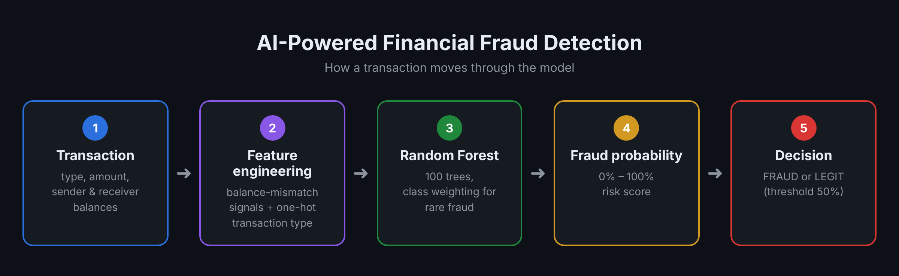

# AI-Powered Financial Fraud Detection

A machine learning project that detects fraudulent transactions in financial data.
It trains a Random Forest classifier, evaluates it with metrics that fit rare-event problems, and lets you check a single transaction from the command line.



## Why this project matters
Fraud is rare (usually well under 1% of transactions), so a model that says "everything is legitimate" is 99%+ accurate but useless. This project handles that imbalance properly and reports precision, recall, and PR-AUC instead of accuracy alone.

## What it does
- Explores the data (size, fraud rate, fraud by transaction type)
- Builds features, including **balance-mismatch signals** that often reveal fraud
- Trains a Random Forest with class weighting for the imbalance
- Evaluates on a held-out 30% test set (stratified split)
- Saves a confusion matrix and feature-importance chart
- Saves the trained model and predicts new transactions

## Dataset
[Synthetic Financial Datasets For Fraud Detection (PaySim)](https://www.kaggle.com/datasets/ealaxi/paysim1) on Kaggle, about 6.3 million simulated mobile-money transactions.
Required columns: `type`, `amount`, `oldbalanceOrg`, `newbalanceOrig`, `oldbalanceDest`, `newbalanceDest`, `isFraud`.
The dataset is not included in this repo because of its size. Download it and place it in a `data/` folder.

## Getting started
```bash
pip install -r requirements.txt

# Train and evaluate
python fraud_detection.py --data data/AIML_Dataset.csv

# Faster run on a random subset
python fraud_detection.py --data data/AIML_Dataset.csv --sample 500000

# Check one transaction with the saved model
python fraud_detection.py --predict
```

## Output
- `outputs/confusion_matrix.png`
- `outputs/feature_importance.png`
- `models/fraud_model.joblib` (not tracked by git)

## Limitations
- The data is **simulated** (PaySim), so results may be higher than on real bank data.
- The dataset authors note that fraudulent transactions were cancelled, which affects the balance columns. The balance-mismatch features are therefore very strong in this dataset and may not carry over the same way to real systems.

## Tech stack
Python, pandas, scikit-learn, matplotlib, joblib

## Possible next steps
- Compare with Gradient Boosting / XGBoost
- Tune the decision threshold for a precision/recall trade-off
- Wrap the model in a small API (Flask / FastAPI)

## Author
[Sara Aljohani](https://github.com/xSarah11)
